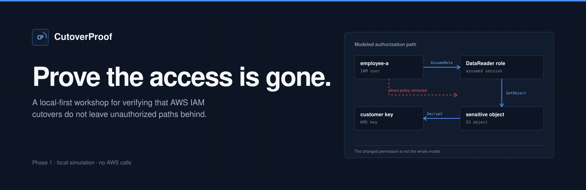
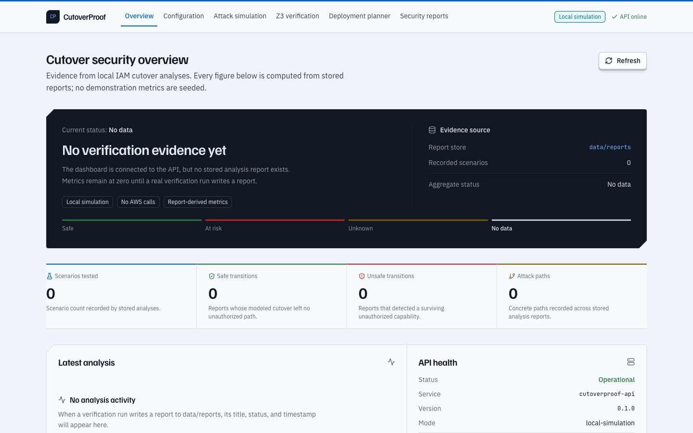
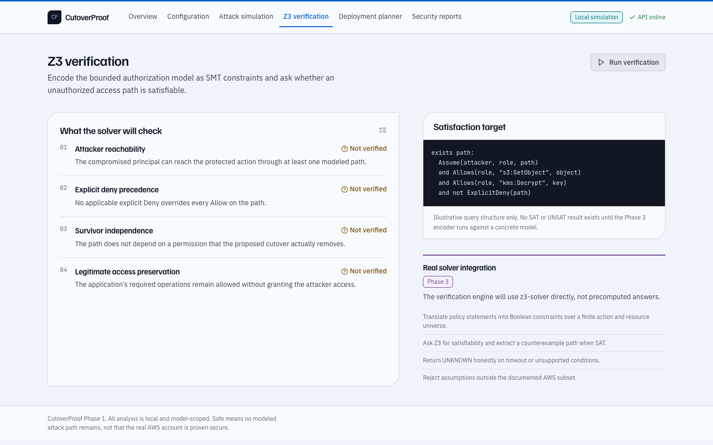
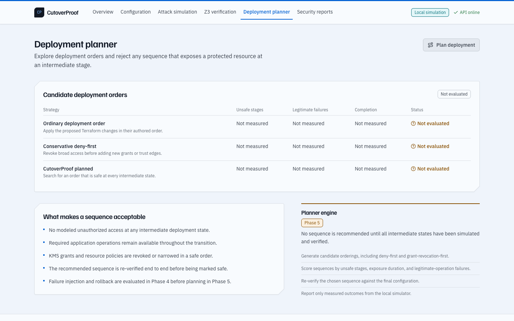
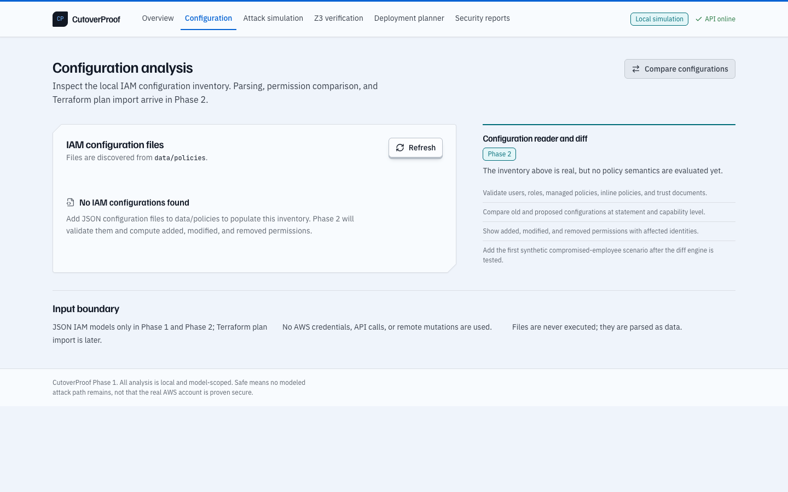
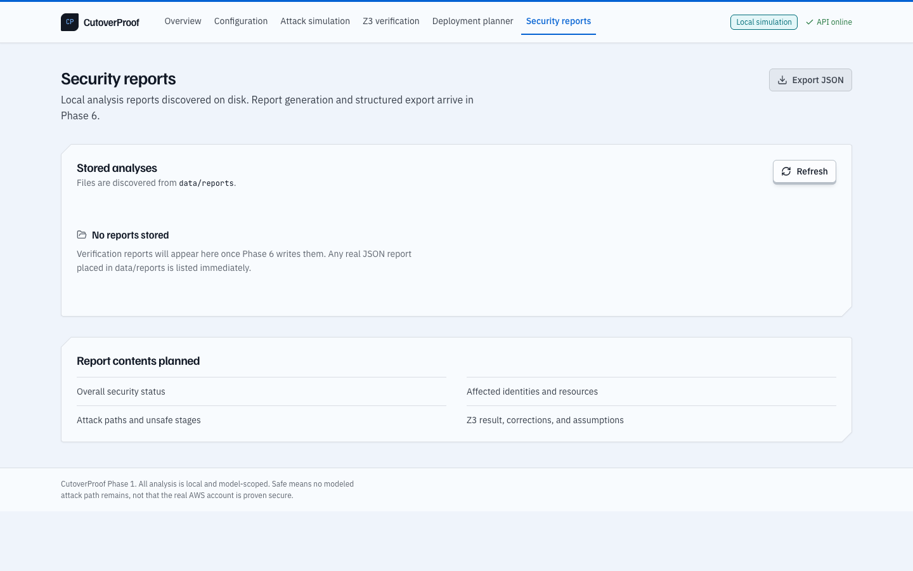
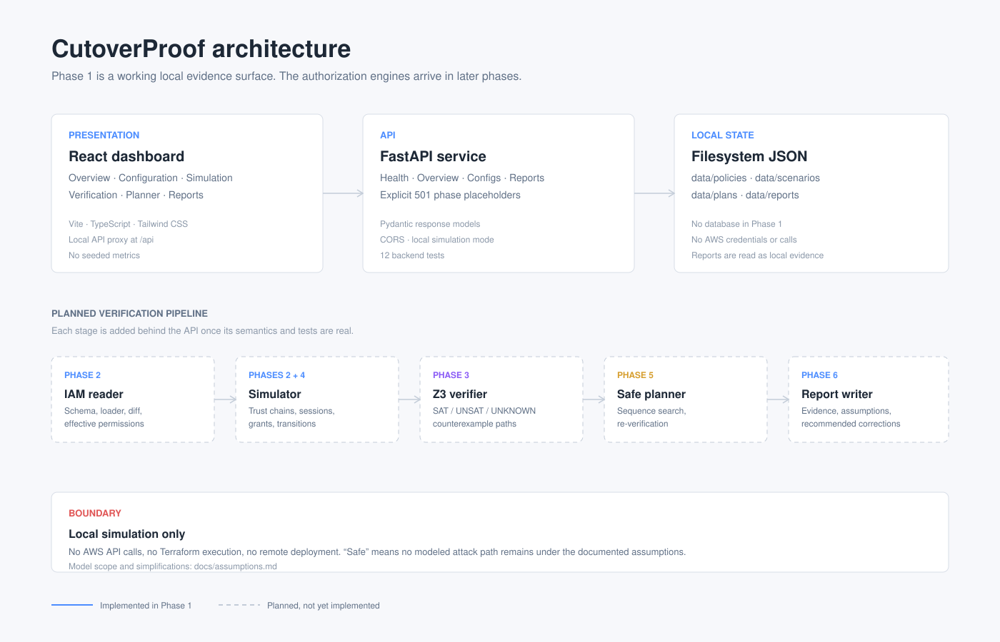

<div align="center">
  <a href="https://github.com/affanbasha247/cutoverproof">
    
  </a>

  <h1>CutoverProof</h1>

  <p><strong>Prove the access is gone, not just the permission.</strong></p>

  <p>A local-first research prototype for temporal AWS IAM cutover verification.</p>

  <p>
    <a href="https://github.com/affanbasha247/cutoverproof/actions/workflows/ci.yml">
      
    </a>
    
    
    
    
    
    
    
    
  </p>
</div>

<p align="center">
  
</p>

> [!IMPORTANT]
> **Phase 1 is the working foundation, not the finished verifier.** The API, report-derived dashboard, local data inventory, and test suite are real. IAM policy evaluation, attack simulation, Z3 verification, deployment planning, and report generation are still ahead. Their endpoints return `501` instead of inventing a result.

## Why this exists

Removing a permission from an IAM policy is a local change. Proving that every route to the protected data is gone is not.

A user can lose a policy and still reach a bucket through a role trust chain, a resource policy, or a KMS grant. A deployment can be safe before and after a cutover while leaving a dangerous window in the middle. CutoverProof is a bounded, local workspace for studying that gap without touching a real AWS account.

The project is being built in phases so each security claim is backed by real code, tests, and a documented model. See [docs/research_gap.md](docs/research_gap.md) for the research framing and [docs/assumptions.md](docs/assumptions.md) for the exact subset.

## What works today

- **FastAPI service** with typed health, overview, configuration, and report endpoints.
- **Evidence-driven dashboard** whose numbers are computed from files in `data/reports`, never seeded constants.
- **Honest empty states.** With no stored reports the dashboard shows `no_data`, not a fabricated “secure” result.
- **Configuration inventory** that lists real JSON files from `data/policies`.
- **Six-screen interface:** Overview, Configuration, Attack Simulation, Z3 Verification, Deployment Planner, and Security Reports.
- **Phase-gated controls.** Unimplemented engines return HTTP `501` with the phase that owns them.
- **12 backend tests** covering API responses, report aggregation, inventory metadata, and path traversal rejection.
- **No cloud dependency.** The app runs from local files with no AWS credentials, Terraform execution, or network calls to AWS.

## A look at the interface

<p align="center">
  <a href="docs/images/screenshots/overview.png">
    
  </a>
</p>

<table>
  <tr>
    <td width="50%">
      <a href="docs/images/screenshots/verification.png">
        
      </a>
      <sub><strong>Verification.</strong> The conditions that will be encoded, with no verdict until the solver runs.</sub>
    </td>
    <td width="50%">
      <a href="docs/images/screenshots/planner.png">
        
      </a>
      <sub><strong>Planner.</strong> Candidate deployment orders stay unmeasured until transitions can be simulated.</sub>
    </td>
  </tr>
  <tr>
    <td width="50%">
      <a href="docs/images/screenshots/configuration.png">
        
      </a>
      <sub><strong>Configuration.</strong> Real files in <code>data/policies</code>, ready for the Phase 2 reader.</sub>
    </td>
    <td width="50%">
      <a href="docs/images/screenshots/reports.png">
        
      </a>
      <sub><strong>Reports.</strong> Stored evidence is already readable; generation and export arrive in Phase 6.</sub>
    </td>
  </tr>
</table>

The simulation screen is also implemented as an interface shell: [docs/images/screenshots/simulation.png](docs/images/screenshots/simulation.png).

## Architecture

<p align="center">
  
</p>

Phase 1 keeps the boundary deliberately small:

```text
React dashboard
      │  /api through Vite's local proxy
      ▼
FastAPI routes ──► local JSON directories
      │
      └── 501 placeholders for engines that do not exist yet
```

The policy reader, attack simulator, Z3 verifier, planner, and report writer are designed as separate modules behind the same API. They are added only when their semantics and tests are real. More detail lives in [docs/architecture.md](docs/architecture.md).

## Technology

| Layer | Choice | Why it is here |
|---|---|---|
| API | FastAPI 0.115, Pydantic 2.10 | Typed response models and a small, readable service surface. |
| Server | Uvicorn | Local development with reload support. |
| UI | React 18, TypeScript 5.7 | Component structure and type-checked API contracts. |
| Build | Vite 6 | Fast local feedback and a simple `/api` proxy. |
| Styling | Tailwind CSS 3.4, custom CSS tokens | A restrained security workspace with a portable token layer. |
| Icons | Lucide | One icon family, used sparingly. |
| Tests | Pytest 8, FastAPI TestClient | Security-critical API behavior stays covered. |
| Data | Local JSON files | No database until persistence genuinely needs one. |
| Verification (planned) | Z3 | Real SMT checks in Phase 3, not precomputed verdicts. |

## Run it locally

### Requirements

- Python 3.9 or newer
- Node.js 20 or newer with npm
- No AWS account or cloud credentials

### 1. Start the backend

```bash
cd backend
python3 -m venv .venv
source .venv/bin/activate
python -m pip install --upgrade pip
python -m pip install -r requirements.txt
python -m uvicorn app.main:app --reload --port 8000
```

Check it:

```bash
curl http://127.0.0.1:8000/api/health
curl http://127.0.0.1:8000/api/overview
```

OpenAPI docs are served at <http://127.0.0.1:8000/docs>.

### 2. Start the frontend

In a second terminal:

```bash
cd frontend
npm install
npm run dev
```

Open <http://localhost:5173>. The dashboard talks to FastAPI through Vite's proxy, so there is no separate CORS setup for local development.

### 3. Run the checks

```bash
cd backend
source .venv/bin/activate
python -m pytest -q
```

```bash
cd frontend
npm run build
```

The build runs `tsc --noEmit` before Vite bundles the app.

## Configuration

Backend settings use the `CUTOVERPROOF_` prefix and can be placed in `backend/.env`.

| Variable | Default | Purpose |
|---|---|---|
| `CUTOVERPROOF_APP_NAME` | `CutoverProof API` | FastAPI title. |
| `CUTOVERPROOF_VERSION` | `0.1.0` | Reported service version. |
| `CUTOVERPROOF_MODE` | `local-simulation` | Execution mode shown in health responses. |
| `CUTOVERPROOF_CORS_ORIGINS` | local Vite origins | JSON list of allowed browser origins. |
| `VITE_API_BASE_URL` | `/api` | Frontend API base; change only when bypassing the Vite proxy. |

`backend/.env` is ignored by Git. Local data lives in four folders:

```text
data/policies/     IAM configuration JSON
data/scenarios/    Attacker and transition scenarios
data/plans/        Deployment plans
data/reports/      Stored analysis reports
```

The Overview and Reports screens read any JSON report placed in `data/reports`. A report can contribute `security_status`, `scenarios_tested`, `attack_paths`, `title`, and `created_at`.

## API

| Method | Endpoint | Status | Purpose |
|---|---|---|---|
| `GET` | `/api/health` | Working | Service name, version, and mode. |
| `GET` | `/api/overview` | Working | Totals computed from stored report files. |
| `GET` | `/api/configs` | Working | Inventory of `data/policies/*.json`. |
| `GET` | `/api/reports` | Working | Stored report inventory. |
| `GET` | `/api/reports/{id}` | Working | Raw local report JSON. |
| `POST` | `/api/analysis/run` | `501` | Phase 2 configuration reader and diff. |
| `POST` | `/api/simulation/run` | `501` | Phase 2 and 4 attack simulation. |
| `POST` | `/api/verification/run` | `501` | Phase 3 Z3 verification. |
| `POST` | `/api/planner/run` | `501` | Phase 5 safe deployment planning. |

Example:

```bash
curl http://127.0.0.1:8000/api/overview
```

```json
{
  "scenarios_tested": 0,
  "safe_transitions": 0,
  "unsafe_transitions": 0,
  "attack_paths": 0,
  "latest_activity": null,
  "security_status": "no_data"
}
```

No endpoint currently produces a SAT/UNSAT verdict, an attack path, or a deployment plan.

## Project layout

```text
CutoverProof/
├── backend/
│   ├── app/
│   │   ├── api/            Typed routes and Phase 1 response models
│   │   ├── core/           Settings and repository paths
│   │   ├── policy/         IAM reader and evaluator (Phase 2)
│   │   ├── simulator/      Attack paths and transitions (Phase 2/4)
│   │   ├── verification/   Z3 encoding (Phase 3)
│   │   ├── planner/        Safe sequencing (Phase 5)
│   │   └── reports/        Report aggregation and storage
│   ├── tests/              12 API and security tests
│   └── requirements.txt
├── frontend/
│   └── src/
│       ├── components/     Shell, controls, states
│       ├── pages/          Six dashboard screens
│       ├── services/       Typed API client and formatting
│       ├── hooks/          Fetch state
│       ├── types/          API contracts
│       ├── tokens.css      Cobalt design tokens
│       └── index.css       Application styles
├── data/                   Local policies, scenarios, plans, reports
├── docs/
│   ├── architecture.md
│   ├── assumptions.md
│   ├── research_gap.md
│   └── images/             Brand assets and real application screenshots
├── .github/                CI and contribution templates
├── design.md               Locked visual system
└── README.md
```

## Security and model scope

CutoverProof is intentionally not a cloud control plane.

- It never calls AWS and never applies Terraform.
- It stores no credentials and requires no cloud account.
- A “safe” result will always mean safe **inside the documented model**, not proven secure in a live account.
- Unsupported behavior must return `UNKNOWN` or an explicit error, never a guessed verdict.
- The current dashboard status is `no_data` until a real report exists.

If you find a security issue in the project itself, follow [SECURITY.md](SECURITY.md) rather than opening a public issue. The authorization model and its present limits are documented in [docs/assumptions.md](docs/assumptions.md).

## Research context

The intended contribution is a bounded temporal authorization verification and repair approach: surviving capabilities, deployment propagation, failure and rollback behavior, and preservation of legitimate application access. It does not claim that checking intermediate deployment states alone is new; Hayha and related work already study that problem.

The research questions, non-claims, and evaluation plan are in [docs/research_gap.md](docs/research_gap.md). Experimental results will be added only after the harness produces them.

## Roadmap

| Phase | Scope | State |
|---|---|---|
| 1 | Local API, report evidence dashboard, configuration inventory, tests | Complete |
| 2 | IAM JSON schema, loader, permission diff, effective-permission evaluator, first attack scenario | Next |
| 3 | Z3 encoding, SAT/UNSAT/UNKNOWN, counterexample paths | Planned |
| 4 | Intermediate deployment states, sessions, KMS grants, delays, failures | Planned |
| 5 | Safe deployment planner with legitimate-access preservation | Planned |
| 6 | Full dashboard wiring, attack-path views, JSON report export | Planned |
| 7 | Baseline comparison and documented evaluation results | Planned |

## Contributing

Contributions are welcome when they respect the project's honesty boundary: no invented metrics, no unverified security verdicts, and no cloud calls.

- Read [CONTRIBUTING.md](CONTRIBUTING.md) before opening a pull request.
- Use the issue templates for bugs and scoped feature proposals.
- Run `pytest` and `npm run build` before submitting.
- Follow [CODE_OF_CONDUCT.md](CODE_OF_CONDUCT.md).

## License

No license has been added yet. Until a license is selected, the source is available for reading and evaluation but is not licensed for redistribution. MIT is the recommended next step for this repository.

---

<p align="center">
  <sub>Built and maintained by <a href="https://github.com/affanbasha247">@affanbasha247</a>. Local-first by design.</sub>
</p>
